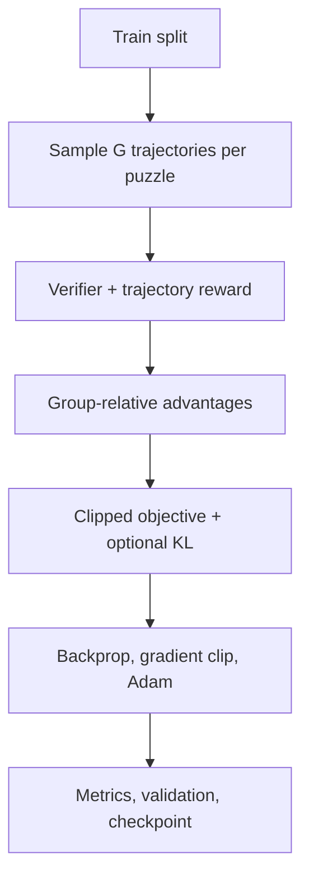

# Countdown Solver with Reinforcement Learning and GRPO

> Dự án học tập/nghiên cứu về khả năng học policy giải Countdown bằng Group Relative Policy Optimization (GRPO). Đây không phải tuyên bố rằng RL vượt trội hơn tìm kiếm xác định.

Policy PyTorch học từ các puzzle được sinh và chấm bằng verifier. Repository còn có MCTS + PUCT, Q-learning tabular và exact DFS memoized. Chế độ `solve` thử GRPO trước rồi gọi exact search nếu policy thất bại; nguồn nghiệm được báo riêng.

## Mục lục

- [Tổng quan](#tổng-quan)
- [Countdown Numbers Game](#countdown-numbers-game)
- [Vì sao nghiên cứu Countdown bằng RL?](#vì-sao-nghiên-cứu-countdown-bằng-rl)
- [RL và tìm kiếm](#rl-và-tìm-kiếm)
- [Nền tảng RL](#nền-tảng-rl)
- [GRPO và objective trong code](#grpo-và-objective-trong-code)
- [Kiến trúc và luồng dữ liệu](#kiến-trúc-và-luồng-dữ-liệu)
- [Cài đặt Windows](#cài-đặt-windows)
- [CLI](#cli)
- [Train và checkpoint](#train-và-checkpoint)
- [Đánh giá và benchmark](#đánh-giá-và-benchmark)
- [Test và xử lý sự cố](#test-và-xử-lý-sự-cố)
- [Giới hạn và hướng phát triển](#giới-hạn-và-hướng-phát-triển)
- [Glossary](#glossary)
- [Tài liệu tham khảo](#tài-liệu-tham-khảo)

## Tổng quan

### Mục tiêu và tính năng

Countdown nhận một tập số nguyên dương và Target. Mỗi lượt chọn hai số còn lại, thực hiện phép toán hợp lệ và thay hai toán hạng bằng kết quả. Mục tiêu mặc định là dùng hết số và kết thúc chính xác ở Target.

Đã triển khai: môi trường MDP tự viết; policy DeepSets action-level bằng PyTorch; train/eval GRPO; verifier độc lập; checkpoint có metadata và data splits; exact-search fallback; MCTS + PUCT; Q-learning; benchmark; hiển thị các bước bằng Matplotlib và cây DOT/PNG tùy Graphviz.

Giới hạn: exact solve rate của GRPO trong báo cáo đã lưu còn thấp; distribution dữ liệu được sinh theo construction có nghiệm; benchmark best-of-N hiện có thể nhầm nghiệm search thành GRPO (xem [Đánh giá](#đánh-giá-và-benchmark)). Repository không có file dependency declaration, license hay CI. Môi trường đã kiểm tra: Python 3.14.6, PyTorch 2.14.1+cpu, Matplotlib 3.11.2; đây không phải tuyên bố tương thích với mọi phiên bản/phần cứng.

## Countdown Numbers Game

`CountdownEnv.get_valid_actions()` trong [countdown_env.py](countdown_env.py) và `verify_trajectory()` trong [grpo_agent.py](grpo_agent.py) xác định luật thực tế:

1. Chọn hai lần xuất hiện trong multiset hiện tại (cùng giá trị cần hai bản sao).
2. `+` và `*` dùng phép cộng/nhân nguyên.
3. `-` chỉ hợp lệ nếu hiệu dương; action có hướng sao cho `left - right = result > 0`.
4. `/` chỉ hợp lệ khi chia hết, mẫu khác 0, thương nguyên dương.
5. Bỏ hai toán hạng, thêm kết quả, sắp xếp state tuple.
6. Mặc định phải dùng hết số (`require_use_all=True`); `--allow-partial` cho phép kết thúc khi đạt Target sớm.

CLI chấp nhận 2–8 số nguyên dương và Target dương. Không dùng số âm, số thập phân hay toán tử khác `+ - * /`.

Ví dụ verifier chấp nhận:

```text
Numbers: 25 50 3 6 7 8
Target: 952
25 - 6 = 19
3 + 7 = 10
19 * 50 = 950
10 - 8 = 2
950 + 2 = 952
```

\[
((25-6)\times50)+((3+7)-8)=952.
\]

Mỗi phép tính dùng đúng hai số đang có rồi thay chúng bằng kết quả. Vì vậy các số trung gian có thể tiếp tục được dùng; mỗi số gốc được tiêu thụ đúng một lần.


## Vì sao nghiên cứu Countdown bằng RL?

State/action rời rạc và luật dễ kiểm chứng, nhưng mỗi quyết định làm thay đổi tập phép tính còn lại. Có thể khảo sát exploration, reward shaping, state/action representation và khả năng tổng quát hóa trên nhiều puzzle. Verifier độc lập phân biệt action hợp lệ với nghiệm chính xác; metric có thể gồm exact solve rate, valid trajectory rate, độ gần Target và độ dài trajectory.

Các khó khăn gồm combinatorial branching, nhiều đường tạo cùng state, reward cuối episode bị trễ, sampling lặp, reward shaping có thể lệch mục tiêu và train/test distribution shift. Generator hiện tại tạo puzzle có nghiệm bằng chuỗi phép tính hợp lệ; đây là phân phối constructive, không phải mẫu đều từ mọi puzzle.

Countdown không đòi hỏi RL: DFS memoized và những thuật toán chuyên biệt có thể giải trực tiếp. Mục tiêu nghiên cứu là liệu policy có học được cách chọn action qua nhiều puzzle hay không, không phải chứng minh RL là solver tối ưu.

## RL và tìm kiếm

### DFS, BFS, A*, greedy và beam

- **DFS (Depth-First Search):** đi sâu một nhánh rồi quay lui. Bộ nhớ đường đi thường nhỏ; memoization tăng bộ nhớ theo số state đã lưu. DFS exhaustive trên không gian hữu hạn có thể đầy đủ. Trong Countdown mỗi action giảm số phần tử đi một, nên độ sâu tối đa `k−1`; `countdown_search.solve_countdown_exact()` dùng DFS memo hóa state và trả nghiệm đầu tiên, không tối ưu tiêu chí phụ.
- **BFS (Breadth-First Search):** mở rộng theo từng độ sâu. Với branching hữu hạn và chi phí action bằng nhau, đầy đủ và trả đường đi ít bước nhất; frontier tốn nhiều bộ nhớ.
- **A*:** ưu tiên `f(n)=g(n)+h(n)`, trong đó `g` là chi phí đã đi, `h` ước lượng còn lại. Tính tối ưu phụ thuộc heuristic admissible cùng các điều kiện tìm kiếm. Countdown khó có heuristic admissible đủ hữu ích vì nhân/chia có thể đổi khoảng cách Target mạnh. Không có A* trong repo.
- **Greedy search:** ưu tiên heuristic tức thời; có thể bỏ mất nhánh cần thiết. **Beam search** chỉ giữ `beam width` ứng viên mỗi tầng nên cũng không đảm bảo tìm nghiệm. Repo không có beam solver.
- **Dynamic programming:** có thể lưu tập kết quả theo subset số đã dùng. `countdown_search.py` hiện là DFS memoized theo multiset state, không phải subset DP.

RL học policy từ trải nghiệm nhiều instance; search duyệt từng instance. RL có tiềm năng hướng dẫn hành động trên puzzle mới nhưng không đảm bảo nghiệm, không tự động nhanh hơn và cần chi phí huấn luyện.

| Tiêu chí | DFS/BFS | A* | Beam/Greedy | RL/GRPO |
|---|---|---|---|---|
| Heuristic | Không bắt buộc | Có | Thường có | Policy học điểm action |
| Huấn luyện trước | Không | Không | Không nhất thiết | Có |
| Bảo đảm tìm nghiệm | Nếu exhaustive/finite thích hợp | Tùy heuristic/điều kiện | Không nói chung | Không |
| Học qua nhiều puzzle | Không mặc định | Không mặc định | Không mặc định | Mục tiêu phương pháp |
| Cài trong repo | DFS memoized | Không | Không | Có; thêm MCTS/Q-learning |

GRPO thuần, GRPO+search và search-only phải được báo tách biệt. Search solver là baseline, không phải bằng chứng policy đã giải được puzzle.

## Nền tảng RL

### Agent, environment và MDP

Reinforcement Learning (học tăng cường) tối ưu hành vi agent bằng tương tác. Agent nhận state, chọn action, environment trả reward và state kế tiếp:


MDP lý thuyết là `𝓜=(𝓢,𝓐,P,R,γ)`: state space, action space, xác suất chuyển, reward và discount factor. Trong Countdown, transition xác định nên `P(s'|s,a)=1`. `CountdownEnv` là class Python riêng, không kế thừa Gymnasium và không dùng Gymnasium API.

State là tuple số còn lại đã sort, ví dụ `(3,6,7,8,25,50)`; Target được truyền riêng. Action môi trường gồm `(left, op, right, result, next_state)`. Policy được mô tả `π(a|s,target)`.

### Episode, return, policy và exploration

Timestep là một phép tính; episode là các bước từ puzzle đầu đến terminal/no-action/max-step. Trajectory `τ` lưu cả chuỗi. Return lý thuyết có thể là:

\[
G_t=\sum_{k=0}^{T-t-1}\gamma^k r_{t+k}.
\]

GRPO implementation không dùng discounted return: trajectory nhận một scalar reward verifier-level và mọi action trong trajectory dùng chung advantage. `gamma` trong `rl_agent.py` thuộc Q-learning/MCTS legacy.

Policy `πθ(a|s,target)` là phân phối xác suất trên action hợp lệ. Stochastic sampling tạo trajectory đa dạng (exploration); greedy argmax khai thác action có logit cao nhất (exploitation). Entropy đo độ phân tán phân phối, không chứng minh độ chính xác.

Value/Q lý thuyết:

\[
V^\pi(s)=\mathbb{E}_\pi[G_t|S_t=s],\quad
Q^\pi(s,a)=\mathbb{E}_\pi[G_t|S_t=s,A_t=a].
\]

Reward là tín hiệu nhận được; value/Q dự đoán return tương lai. GRPO không có critic/value network; Q-learning riêng dùng Q-table.

### Policy gradient và advantage

Policy gradient tổng quát tăng log-prob action gắn với outcome tốt:

\[
\nabla_\theta J(\theta)=
\mathbb{E}[\nabla_\theta\log\pi_\theta(a_t|s_t)G_t].
\]

Một baseline `b` tạo advantage `A=R−b`. Trong code, với reward trajectory `R_i` của cùng một puzzle:

\[
A_i=\frac{R_i-\operatorname{mean}(R)}
{\operatorname{std}(R)+\epsilon}.
\]

Dùng population standard deviation trong group; nếu `std < 1e−8`, mọi advantage bằng 0. Epsilon mặc định `1e−4`. Chuẩn hóa trên trajectory, không phải từng action; tất cả action của một trajectory chia sẻ cùng `A_i`.

## GRPO và objective trong code

GRPO (Group Relative Policy Optimization) được DeepSeekMath giới thiệu như biến thể PPO, dùng reward tương đối trong group và không cần critic/value model riêng. Repository dùng adaptation action-level cho Countdown, không phải objective token-level LLM nguyên bản.

Với `G` trajectory cùng puzzle, `πold` là policy khi lấy mẫu, `πθ` là policy đang cập nhật:

\[
\rho_{i,t}(\theta)=
\frac{\pi_\theta(a_{i,t}|s_{i,t},T_i)}
{\pi_{old}(a_{i,t}|s_{i,t},T_i)}.
\]

Loss thực tế lấy negative clipped surrogate, trung bình action trong từng trajectory rồi tổng hợp các trajectory có advantage khác 0:

\[
L_{clip}=-\operatorname{mean}_i\frac{1}{|\tau_i|}\sum_t
\min(\rho_{i,t}A_i,
\operatorname{clip}(\rho_{i,t},1-\epsilon,1+\epsilon)A_i).
\]

`old_log_prob` lưu lúc sample; current log-prob tính lại để backprop. `--inner-epochs` tái sử dụng mẫu theo kiểu PPO. Gradient norm được clip trước Adam step.

Khi `--kl-coeff β > 0`, code cộng KL action-distribution với frozen reference:

\[
\beta\,\mathbb{E}_{s,t}
[D_{KL}(\pi_\theta(\cdot|s,t)\|\pi_{ref}(\cdot|s,t))].
\]

Reference là bản sao policy ban đầu, không optimizer-update; `β=0` mặc định tắt KL.

### Reward: env khác GRPO

`CountdownEnv.step_state()` reward theo bước: khi dùng hết số, terminal chính xác `+100`, sai `−10−distance/100`; bước trung gian có `−0.1`, shaping theo thay đổi khoảng cách nhỏ nhất tới Target và `+2` bonus nếu kết quả là ước số dương của Target. GRPO không dùng tổng env reward làm objective. `calculate_trajectory_reward()` dùng verifier:

| Kết quả trajectory | Reward |
|---|---:|
| Verifier xác nhận thành công | `+1` |
| Không hợp lệ | `−1` |
| Hợp lệ nhưng không đạt | `−0.5 + 0.5 × credit` |

`credit=max(0,1−min_error/max(1,|Target|))`; `min_error` là khoảng cách nhỏ nhất trong số ban đầu và kết quả trung gian. Vì vậy metric error không nhất thiết là sai số giá trị cuối.

## Kiến trúc và luồng dữ liệu

### Policy

`PolicyNetwork` dùng DeepSets-like encoder: mỗi số có 5 feature; masked mean + max pooling tạo biểu diễn không phụ thuộc thứ tự; Target có 4 feature; action có 9 feature gồm toán hạng/kết quả/log-result/one-hot operator/độ gần Target. Scorer MLP tạo một logit cho mỗi action hợp lệ môi trường cung cấp; `Categorical` chỉ phân phối xác suất trên danh sách này. `d_model=64` mặc định, code ghi chú khoảng 50k tham số.

### Train flow



`generate_solvable_instances()` chọn 4–6 số từ `[1…10,25,50,75,100]` có lặp; áp dụng action hợp lệ đến khi còn một số; số cuối là Target nếu thuộc `[100,999]`; generator giới hạn intermediate `≤10000`. `make_data_splits()` loại trùng `(sorted numbers,target)` giữa train/val/test. Tập held-out vẫn do cùng generator tạo, nên chỉ đo tổng quát hóa trong phân phối đó.

### Search và visualization

- `countdown_search.py`: DFS memoized, bỏ state/child state tương đương, trả nghiệm đầu tiên và xác minh verifier.
- `GRPOAgent.solve()`: greedy rollout rồi mặc định 32 trajectory sample; nếu fail, gọi exact DFS.
- `tree_visualizer.SearchTreeRecorder`: ghi trajectory GRPO ở depth 0–2; số node DOT không bằng số state exact search.
- `rl_agent.py`: MCTS prior dựa khoảng cách Target/ước số, PUCT (`c_puct=2`), tối đa 10 restart × 3.000 simulation/restart mặc định, rollout có heuristic/random choice. Q-learning tabular dùng ε-greedy, TD update và JSON Q-table (`alpha=0.25`, `gamma=0.95`, tối đa 15.000 episode mặc định).
- Giao diện Matplotlib hiển thị số đang có, action hiện tại, số còn lại, biểu thức ghép và nút lùi/tiến từng bước. Với không tìm thấy nghiệm, hiển thị trạng thái thất bại.

### Cấu trúc thư mục

```text
CD/
├── main.py                  # CLI train/eval/solve, Matplotlib
├── grpo_agent.py            # policy, verifier/reward, GRPO, checkpoint
├── countdown_env.py         # valid actions, transition, env reward
├── countdown_search.py     # exact DFS memoized fallback
├── rl_agent.py              # MCTS + PUCT, Q-learning
├── benchmark.py             # bảng so sánh solver
├── tree_visualizer.py       # Graphviz DOT/PNG
├── test_grpo.py             # unittest
├── input.txt                # puzzle mặc định
├── ketqua.txt               # báo cáo run (bị ghi đè)
├── tree.dot                 # cây trajectory (bị ghi đè khi solve)
├── benchmark_result.txt     # benchmark đã lưu
├── grpo_train_log*.txt      # log đã lưu
├── grpo_checkpoint*/        # các checkpoint
├── q_table.json             # Q table
└── _backup_before_grpo/     # artifact cũ
```

Ngoài source, các thư mục checkpoint/log là dữ liệu thực nghiệm; giữ riêng theo thí nghiệm. `.venv` là local environment, không phải requirements declaration.

## Cài đặt Windows

Repository không có `requirements.txt`. Dependency ngoài được xác nhận từ import: PyTorch và Matplotlib. Graphviz `dot` là tùy chọn ngoài để render PNG; không cần để tạo DOT. Không cần NumPy/Pandas/Gymnasium/CUDA theo source hiện tại.

PowerShell tại repository:

```powershell
py -3.14 -m venv .venv
.\.venv\Scripts\Activate.ps1
python -m pip install --upgrade pip
python -m pip install torch matplotlib
python -c "import sys, torch, matplotlib; print(sys.version); print(torch.__version__); print(matplotlib.__version__)"
python -m unittest test_grpo -v
```

Đã kiểm tra Python 3.14.6, PyTorch 2.14.1+cpu, Matplotlib 3.11.2. Nếu cài Python khác, tương thích chưa được xác nhận ở đây. GPU chưa kiểm thử; chọn wheel theo máy bằng [PyTorch install guide](https://pytorch.org/get-started/locally/). Nếu PowerShell chặn activate, gọi trực tiếp `\.venv\Scripts\python.exe`.

## CLI

Không truyền `--mode` tương đương `solve`.

### Solve

```powershell
python main.py --mode solve --no-gui --grpo-file grpo_checkpoint
```

Đọc `input.txt`, nạp checkpoint, thử GRPO rồi exact search fallback; verifier kiểm tra kết quả. Ghi `ketqua.txt`, `tree.dot`; nếu Graphviz có trên PATH render `tree.png`. Bỏ `--no-gui` để mở Matplotlib. `--allow-partial` cho phép hoàn thành sớm.

### Train

```powershell
python main.py --mode train --grpo-file grpo_checkpoint_new `
  --train-instances 150 --epochs 30 --group-size 8 --seed 7
```

Tạo splits, train và ghi checkpoint. Nếu folder có `policy.pt`, CLI warm-start policy nhưng tạo Adam optimizer mới, không tiếp tục moment optimizer. Dùng folder khác cho run mới để không ghi đè checkpoint.

### Eval

```powershell
python main.py --mode eval --grpo-file grpo_checkpoint --best-of-n 16
```

Đánh giá held-out test split lưu trong metadata. N=1 greedy; N>1 sampling N trajectory mỗi puzzle, chọn nghiệm exact đã verifier nếu có. Phần diagnostic cho `input.txt` gọi solve adapter (có fallback) và ghi nguồn riêng; không gộp với held-out metrics.

### Tham số parser

| Option | Default | Ý nghĩa |
|---|---:|---|
| `--mode` | `solve` | `solve`, `train`, `eval` |
| `--grpo-file` | `grpo_checkpoint` | Thư mục checkpoint |
| `--train-instances` | 100 | Số puzzle train |
| `--eval-instances` | 50 | Số puzzle eval nếu metadata thiếu test split |
| `--seed` | không đặt | Seed Python/Torch và generator train |
| `--eval-seed` | không đặt | Seed sinh test nếu thiếu test split |
| `--no-gui` | off | Không mở UI khi solve |
| `--allow-partial` | off | Cho phép dừng sớm; held-out eval vẫn dùng config checkpoint |
| `--lr` | 0.003 | Learning rate |
| `--grpo-batch-size` | 4 | Puzzle trong mỗi batch |
| `--group-size` | 8 | Trajectory mỗi puzzle group |
| `--epochs` | 10 | Số epoch |
| `--inner-epochs` | 2 | Reuse group trong PPO-style updates |
| `--max-steps` | 16 | Trần bước/trajectory |
| `--clip-epsilon` | 0.2 | Clipping range |
| `--kl-coeff` | 0.0 | Hệ số KL |
| `--max-grad-norm` | 1.0 | Gradient norm clip |
| `--device` | `cpu` | Torch device |
| `--ckpt-interval` | 2 | Lưu checkpoint mỗi N epoch |
| `--eval-interval` | 2 | Validation mỗi N epoch |
| `--best-of-n` | 16 | Số sample mỗi puzzle trong eval |

Train/eval ghi đè `ketqua.txt`; solve ghi đè `ketqua.txt` và `tree.dot`. Một số log cũ có `--algo grpo`, nhưng parser hiện tại không có option `--algo`.

### Benchmark

```powershell
python benchmark.py --instances 20 --seed 999 --best-of-n 16 `
  --qfile q_table.json --grpo-file grpo_checkpoint
```

Parser `benchmark.py` có các option trên. Script in bảng, không ghi kết quả vào file tự động.

## Train và checkpoint

`run_grpo_train()` sinh splits → `generate_group()` → verifier/reward → group advantage → loss → backward/gradient clip/Adam → metrics/validation → checkpoint. Config mặc định: `lr=0.003`, batch=4 puzzle, group=8 trajectories, 10 epochs, 2 inner epochs, max 16 steps, clip 0.2, KL 0, grad norm 1, CPU.

| Log | Định nghĩa | Cảnh báo diễn giải |
|---|---|---|
| `mean_reward` | Trung bình reward trên trajectories trong epoch | Sampling làm dao động |
| `train_solve` | `solved_groups / steps_per_epoch` | Mẫu số là số batch, không phải số puzzle khi batch>1 |
| `loss` | Trung bình batch loss có cập nhật | Âm không tự động là lỗi |
| `entropy` | Entropy trung bình phân phối action | Thấp không chứng minh policy tốt |
| `dup` | `1 − unique trajectories/group_size`, trung bình group | Cao là ít đa dạng trajectory |
| `val_exact` | Exact rate của greedy policy trên val ở interval | Không phải train success |
| `updates` | Tổng `optimizer.step()` | Không phải số lượt solver hay puzzle |
| `zero_adv_groups` | Group có toàn advantage 0 | Không có tín hiệu cập nhật từ group |

Checkpoint folder gồm `policy.pt`, `reference.pt`, `optimizer.pt`, `meta.json`. Loader yêu cầu `policy.pt` và `meta.json`; reference/optimizer được nạp nếu có. `meta.json` lưu config, train instances, splits, policy update count, history. Seed không lưu toàn RNG state hay library/hardware versions; không bảo đảm bitwise reproducibility. Khi CLI train tiếp checkpoint, optimizer bị khởi tạo mới dù loader có khả năng đọc optimizer state.

## Đánh giá và benchmark

### Metric trong `evaluate_grpo()`

- **Exact solve rate:** puzzle có ít nhất một trajectory trong N mẫu đạt Target và qua verifier / tổng puzzle.
- **Valid solution rate:** trajectory được chọn có `valid=True`. Verifier có thể gọi trajectory hợp lệ về cú pháp/số học dù chưa kết thúc hoặc chưa đạt Target; không đồng nghĩa đã có nghiệm.
- **`mean_abs_error`:** trung bình `min_error` nhỏ nhất được quan sát ở số ban đầu/kết quả trung gian (exact được tính 0). Không nhất thiết là sai số số cuối.
- **`mean_traj_length`:** số action trung bình trajectory được chọn.

Công thức MAE thường là `N⁻¹ Σ |yᵢ−ŷᵢ|`; implementation hiện tại dùng minimum distance dọc trajectory, nên hãy gọi đúng định nghĩa khi báo cáo.

### Kết quả lịch sử và cảnh báo protocol

`benchmark_result.txt` ghi một run 20 puzzle, seed 999, use-all: Classic DFS 20/20; MCTS 20/20; Q-learning 1/20; GRPO random-init 0/20; trained greedy 0/20; trained best-of-16 1/20. MAE ghi tương ứng 0, 0, 144.6, 200.3, 22.6, 22.6. Đây là artifact lịch sử, thiếu timestamp/checkpoint hash để tái lập; không phải benchmark mới.

Trong code hiện tại, `benchmark.evaluate_agent()` gọi `agent.solve()` khi `best_of_n>1`, nhưng `GRPOAgent.solve()` có exact DFS fallback. Vì vậy best-of-N benchmark có thể gán nghiệm search cho GRPO. Nhánh greedy `_greedy_ops()` không dùng fallback. Không diễn giải best-of-N này là GRPO thuần cho tới khi tách policy-only inference.

Protocol công bằng cần cùng held-out set, verifier, seeds và compute budget; ghi riêng greedy, best-of-N policy-only, search-only, kết hợp; báo thời gian/state expansions và lặp nhiều seeds. Bảng sau là placeholder, không phải số 0:

| Phương pháp | Exact/N | Valid/N | Error theo code | Time |
|---|---:|---:|---:|---:|
| GRPO greedy | Chưa đo mới | Chưa đo mới | Chưa đo mới | Chưa đo |
| GRPO best-of-N thuần | Chưa đo sạch | Chưa đo sạch | Chưa đo sạch | Chưa đo |
| GRPO + exact DFS | Chưa benchmark cùng protocol | — | — | — |
| Exact DFS | Chưa benchmark cùng protocol | — | — | — |

## Test và xử lý sự cố

```powershell
python -m unittest test_grpo -v
```

`test_grpo.py` bao gồm env transition/action/reward; verifier (nghiệm 952, reuse/foreign operand/arithmetic/division/subtraction/use-all); policy logits/gradient/sample; group advantage/loss/clipping/KL/update; checkpoint save/load; split không giao; exact search 952/duplicate/partial; solve adapter; MCTS và Q-learning regression.

| Triệu chứng | Kiểm tra | Xử lý |
|---|---|---|
| Thiếu torch/matplotlib | Import đúng virtualenv chưa | Cài dependency vào interpreter đang chạy |
| Không thấy checkpoint | `--grpo-file`, `policy.pt`, `meta.json` | Trỏ đúng folder hoặc train folder mới |
| Weights không tương thích | `d_model`, metadata, phiên bản | Giữ bản cũ; dùng checkpoint/config tương thích |
| GRPO không tìm ra nghiệm | `grpo_verified`, số trajectory, verifier | Không kết luận vô nghiệm; `solve` có exact fallback và ghi nguồn |
| Valid cao, exact thấp | Xem `success` so với `valid` | Valid trajectory có thể chưa hoàn tất |
| Train solve khác val | Split, seed và cách tính log | `train_solve` chia theo batch, cần cẩn trọng |
| Cây DOT nhỏ | `SearchTreeRecorder.MAX_DEPTH=2` | DOT chỉ là rollout minh họa, không phải search expansions |
| Không có PNG | `dot` trên PATH chưa | Cài Graphviz; DOT vẫn dùng được |
| Benchmark best-of cao bất thường | Kiểm tra fallback path | Không dùng làm GRPO thuần nếu chưa tách fallback |
| Lỗi device/tensor | `--device` có khớp PyTorch build và checkpoint không | Thử `--device cpu`; xác nhận checkpoint `d_model` tương thích |

## Giới hạn và hướng phát triển

**Đã xác nhận:** policy exact rate thấp trong artifact lưu; sampling có thể lặp; generator tạo phân phối có nghiệm; benchmark best-of-N có rủi ro contamination; metric `train_solve` và `mean_abs_error` có định nghĩa dễ bị đọc quá rộng.

**Đề xuất, chưa triển khai:** tách policy-only sampling khỏi solve fallback; sửa metric train theo số puzzle; thêm terminal error riêng; benchmark độc lập nhiều seed/độ khó; ablation reward/KL/group size/representation; lưu package versions, RNG state, checkpoint hash; so sánh các solver trên cùng ngân sách.

## Glossary

| Ký hiệu/thuật ngữ | Nghĩa |
|---|---|
| `s`, `a` | State và action |
| `πθ` | Policy tham số hóa |
| `πold` | Policy lúc sinh trajectory; log-prob được lưu |
| `πref` | Reference policy frozen cho KL |
| `R`, `A` | Reward, advantage |
| `ρ` | Tỷ lệ xác suất action policy mới/cũ |
| `ε` | PPO clip range; `εadv` là epsilon advantage |
| Episode/trajectory | Một lần tương tác/chuỗi action trong episode |
| Exact solve | Đạt đúng Target và điều kiện use-all/partial |
| Valid trajectory | Action hợp lệ; chưa chắc đã thành công |
| Memoization | Ghi nhớ state để tránh tính lại |
| Held-out | Split không được dùng để update policy |

## Tài liệu tham khảo

1. Shao, Z. et al. (2024), **DeepSeekMath: Pushing the Limits of Mathematical Reasoning in Open Language Models**, [arXiv:2402.03300](https://arxiv.org/abs/2402.03300). Nguồn GRPO/PPO và huấn luyện suy luận toán học; implementation ở đây khác kiến trúc LLM.
2. Schulman, J. et al. (2017), **Proximal Policy Optimization Algorithms**, [arXiv:1707.06347](https://arxiv.org/abs/1707.06347). Policy gradient surrogate và clipping.
3. Sutton, R. S. & Barto, A. G. (2018), **Reinforcement Learning: An Introduction**, 2nd ed., [MIT Press](https://mitpress.mit.edu/9780262039246/reinforcement-learning/) · [book site](http://incompleteideas.net/book/the-book-2nd.html). MDP, return, value, policy gradient.
4. Mnih, V. et al. (2015), **Human-level control through deep reinforcement learning**, *Nature* 518, 529–533, [DOI](https://doi.org/10.1038/nature14236). Deep Q-network; không phải GRPO trong repo.
5. Alliot, J.-M. (2015), **The (Final) countdown**, [arXiv:1502.05450](https://arxiv.org/abs/1502.05450). Phân tích độ phức tạp và thuật toán Countdown.
6. Hart, P. E., Nilsson, N. J. & Raphael, B. (1968), **A Formal Basis for the Heuristic Determination of Minimum Cost Paths**, *IEEE Transactions on Systems Science and Cybernetics* 4(2), 100–107, [DOI](https://doi.org/10.1109/TSSC.1968.300136). Nền tảng A*.
7. **PyTorch Documentation**, [stable docs](https://docs.pytorch.org/docs/stable/index.html). Tensor, neural networks, autograd, optimizer.
8. **Gymnasium Documentation**, [custom environment tutorial](https://gymnasium.farama.org/main/tutorials/gymnasium_basics/environment_creation/). Tài liệu tham khảo về API môi trường; project không dùng Gymnasium.

## Trích dẫn trong báo cáo

Ghi commit/tag, checkpoint/hash, lệnh, seed, Python/PyTorch, split và ngày chạy. Mẫu (thay bằng dữ liệu thật):

```text
Countdown Solver with Reinforcement Learning and GRPO, (tác giả/nhóm),
GitHub, commit (SHA), truy cập (YYYY-MM-DD).
Run: (command); checkpoint: (hash); seed: (N); Python/PyTorch: (versions);
test split: (mô tả/hash).
```

Không suy luận GRPO giải được puzzle chỉ từ output có deterministic fallback; luôn báo riêng policy-only, search-only và phương pháp kết hợp.
